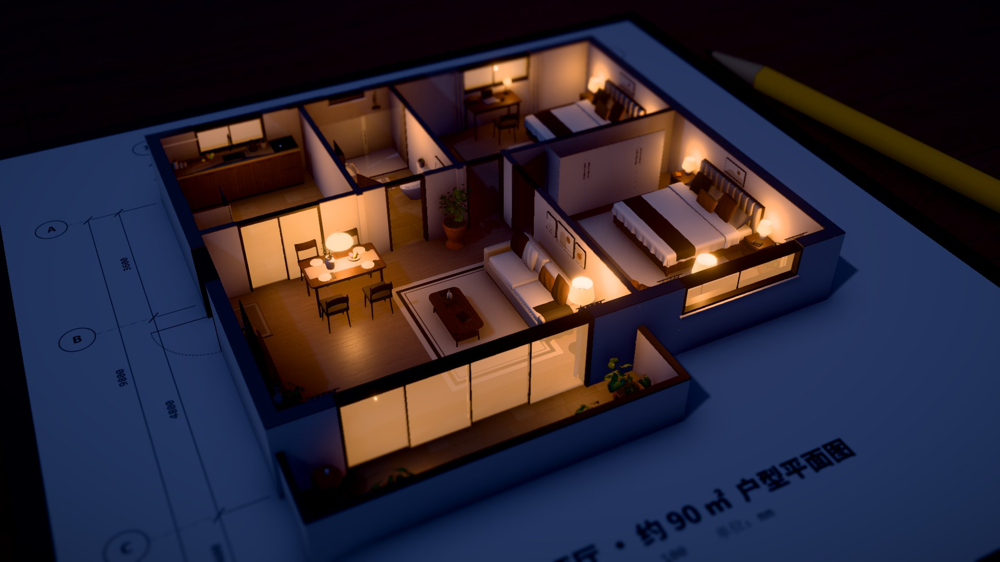
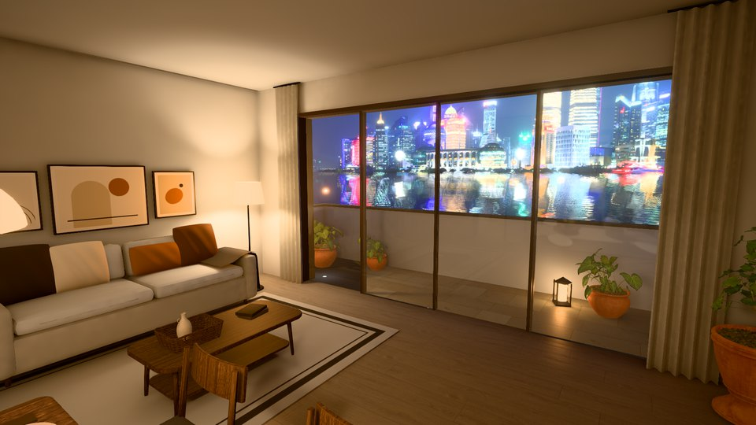
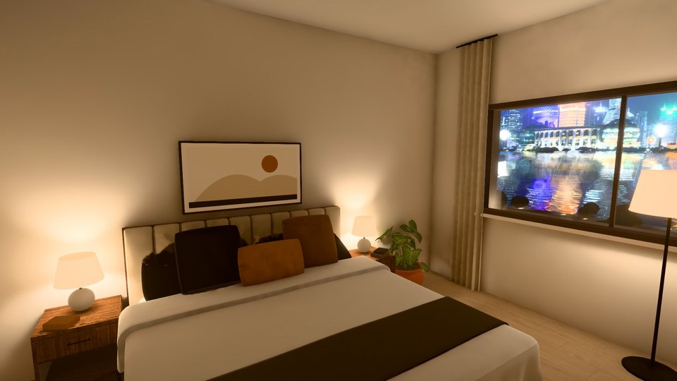
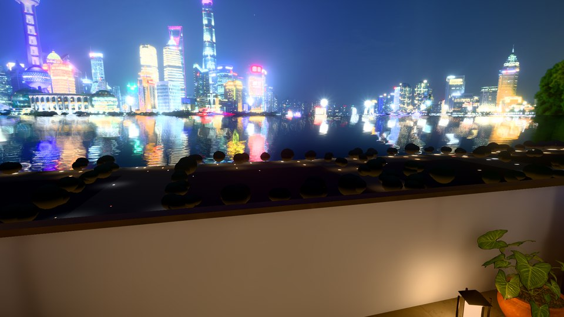

# floorplan-3d-skill：户型图变 3D

> 先读图，再长房子；再住进去走一圈。



把一张户型图交给 Claude Code，它按仓库里的 skill 读图：用尺寸标注定比例尺，量出墙、门窗、房间和家具，写成一份 `plan.json`。网页从这份数据一步步长出整套房子，按规则摆好软装，再用 Blender 烘焙的光照、一条稳稳的第一人称路线，录成一段约 80 秒的漫游视频。

<p>
  
  
  
</p>

示例户型 `opus55` 不是手写的数据：一个只放了户型图和这个 skill 的空文件夹里，Opus 5.5 用 2 分钟读完整张图，3D 就从它写出来的 `plan.json` 长出来（读图过程的终端录像和对照结果见 [`examples/cli-read-opus55-skill/`](examples/cli-read-opus55-skill/)）。

## 这个仓库能干什么

1. **看示例**：装好依赖、下载素材、`npm run dev`，在浏览器里转着看，或者看分步搭建、人眼高度、漫游时间线上的任意一刻。
2. **读你自己的户型图**：在仓库里打开 Claude Code，说"用 floorplan-3d skill 读一下 xxx.png，存成 public/plans/mine.json"，然后打开 `?plan=mine`。`?plan=mine&sheet` 会按数据重画一张户型图，和原图并排看，哪里不一样就是读错了。
3. **真实感画面**：`look=pro&pbr` 换上真实光照、PBR 材质和后期；软装按户型数据自动摆，不用手写坐标。
4. **烘焙光照（可选，要 Blender）**：Blender 脚本建近看也经得住的家具，把整套房子的间接光烘成一张光照贴图，人眼高度看屋里才不像游戏画面。
5. **漫游和录视频**：按"稳、慢、每个房间扫一遍"的规则规划第一人称路线，用无头浏览器 + 虚拟时钟一帧一帧录成 1080p 横版 / 竖版。

skill 本身在 [`.claude/skills/floorplan-3d/`](.claude/skills/floorplan-3d/)：从读图、自检、软装、烘焙到路线和录制的整套步骤，加上踩过的坑。只想读图，把这个文件夹复制到你的项目或 `~/.claude/skills/` 就能用。

## 快速开始

需要 Node.js 22+。

```bash
npm install
node tools/fetch-assets.mjs     # Poly Haven 的 CC0 贴图、模型、天空（约 135 MB，不入库）
npm run dev                     # http://localhost:5182
```

`npm install` 装下来约 230 MB。打开这些网址：

| 看什么 | 网址 |
|---|---|
| 示例户型，分析图风格 | http://localhost:5182/ |
| AI 读出来的户型 | http://localhost:5182/?plan=opus55 |
| 按数据重画的户型图（对照用） | http://localhost:5182/?plan=opus55&sheet |
| 真实感，白天 | http://localhost:5182/?style=e2&stage=6&finish=1&plan=opus55&clean&look=pro&pbr&mood=m2a |
| 真实感，蓝调开灯 | http://localhost:5182/?style=e2&stage=6&finish=1&plan=opus55&clean&look=pro&pbr&mood=m3 |
| 人眼高度（客厅） | http://localhost:5182/?style=e2&stage=6&finish=1&plan=opus55&clean&look=pro&pbr&view=eye&baked |
| 漫游时间线的第 60 秒 | http://localhost:5182/?rec&style=e2&plan=opus55&clean&look=pro&pbr&seq=final&at=60 |

常用网址参数：

| 参数 | 作用 |
|---|---|
| `plan=名字` | 读 `public/plans/名字.json`；不带就用内置的示例户型 |
| `sheet` | 只显示按数据重画的户型图 |
| `stage=1..6` | 分步：图纸 → 读图 → 墙体 → 门窗 → 家具 → 完成；`finish=1` 完成时上色 |
| `style=e2` / `e3` | 单色分析图 / 上色 |
| `view=top` / `view=eye` | 正俯视 / 人眼高度 1.6 米 |
| `cut=1.5` | 墙的剖切高度（米） |
| `clean` | 不显示标题和面积表 |
| `look=pro` | 真实光照 + 后期；加 `pbr` 换 PBR 材质、自动摆软装（`nodecor` 关掉软装） |
| `mood=m2a` / `m3` | 白天 / 蓝调开灯（还有 `m1` `m2b` `m2c` `m4`）；`tod=0..1` 调一天里的时间 |
| `baked` | 配 `view=eye`：用烘焙的光照（没烘焙过就用实时光） |
| `seq=final` | 配 `rec`：漫游成片的时间线；`rec=v` 竖版；`at=秒` 停在那一刻 |
| `night=n1` / `n2` | 窗外夜景：程序城市 / 外滩背景板（默认 n2，要先跑 Blender 那步，没有就自动退回 n1） |
| `cast=名字` | 叠加终端录像回放（`public/casts/名字.cast`） |

## Blender 烘焙（可选）

不烘焙也能看、能录：人眼高度用实时光照，窗外是程序生成的城市。要做到视频里那样（反弹光、外滩江景），装 [Blender](https://www.blender.org/) 5.2，下面的 `blender` 换成它的可执行文件路径：

```bash
npm run dev                                                      # 另开一个终端，导出要用页面
node tools/bake-export.mjs --plan opus55 --set opus55-m5         # 1. 从页面导出整套房子 → out/bake/opus55-m5/
blender -b --factory-startup -P tools/blender/bake.py -- --set opus55-m5 --res 4096 --samples 512   # 2. 烘焙 → public/bake/opus55-m5/
blender -b --factory-startup -P tools/blender/night_plate.py -- --set opus55-m5                     # 3. 外滩背景板（用第 2 步的天空调色）
```

- GTX 1050 Ti 上，4096² 光照贴图、512 采样，整套 30–50 分钟（光照贴图本身 23–38 分钟，另外是扩边、降噪和每个房间一张探针）。先用 `--res 2048 --samples 256` 试一遍快得多。
- 显卡用 CUDA。Pascal 这类没有 RT 核的卡上 OptiX 烘出来是空的，`bake.py` 默认先选 CUDA（`--api` 可指定）。
- 家具模型已经在仓库里（`public/assets/hero/furniture.glb`）。改了家具脚本才需要重建：`blender -b --factory-startup -P tools/blender/furniture.py`。
- 烘焙结果放在 `public/bake/`，不入库。换户型就换 `--plan` 和 `--set`（页面默认找 `<户型>-m5`）。

## 漫游和录视频

```bash
node tools/tour-path.mjs && python tools/tour-path.py            # 不开浏览器：路线画到户型上，查速度、转头、离墙多近
node tools/record.mjs --smooth --q "style=e2&plan=opus55&clean&look=pro&pbr&seq=final"     # 30 帧低分辨率预览，先看稳不稳
node tools/record.mjs --q "style=e2&plan=opus55&clean&look=pro&pbr&seq=final"              # 正式版 1920×1080 → out/floorplan-16x9.mp4
node tools/record.mjs --v --q "style=e2&plan=opus55&clean&look=pro&pbr&seq=final"          # 竖版 1080×1920
```

- 需要 Edge（Windows 自带，或者改 `tools/browser.mjs` 用 Chrome）和 ffmpeg（不在 PATH 里就设环境变量 `FFMPEG`）。`tools/` 里的 Python 脚本要 Pillow、numpy、matplotlib。
- 录制用虚拟时钟：电脑渲染一帧多慢都没关系，录出来是匀速的。1050 Ti 上 80 秒的 1080p 约 6 分钟。
- `--preview` 是 10 帧预览，会把转身放大成一顿一顿的；判断稳不稳看 `--smooth`。`python tools/judder.py 视频.mp4` 逐帧查抖动和闪。
- 漫游路线（`src/look/tour.js` 的 `ROUTE`）现在是给 `opus55` 写的。换成你的户型，让 Claude 按 skill 里的规则重写路线，再用 `tour-path` 检查。

## 文件

| 文件 | 管什么 |
|---|---|
| `.claude/skills/floorplan-3d/` | Claude Code skill：整套流程、`plan.json` 格式、画质和烘焙、漫游规则、踩过的坑 |
| `public/plans/` | 读图结果（`opus55.json` 是 Opus 5.5 + skill 读的） |
| `src/plan/` | 示例户型、CAD 风格的户型图绘制、加载和补默认值 |
| `src/build/` | 墙（按门窗洞口切开）、门窗、地面、家具库、上色 |
| `src/look/` | 真实感：光照和氛围（`look.js`）、软装规则（`decor.js`）、PBR 材质、灯、门、烘焙加载（`bake.js`）、夜景、漫游路线（`tour.js`） |
| `src/director.js` | 录视频的时间线和镜头 |
| `tools/blender/` | Blender 脚本：家具建模、烘焙光照贴图、外滩背景板 |
| `tools/` | 素材下载、截图、逐帧录制、路线检查、抖动检查、终端录制和打码 |
| `examples/` | 不同模型、有没有 skill 的读图结果对比 |
| `docs/BUILD_LOG.md` | 一轮一轮怎么做出来的 |

外部素材来自 Poly Haven（CC0），清单见 [`public/assets/CREDITS.md`](public/assets/CREDITS.md)。

由 [徐行 @xuxing_ai](https://x.com/xuxing_ai) 和 Claude 一起做。MIT 协议。
